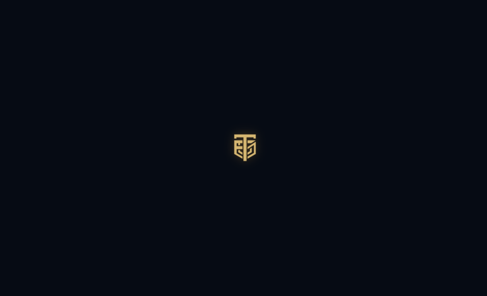
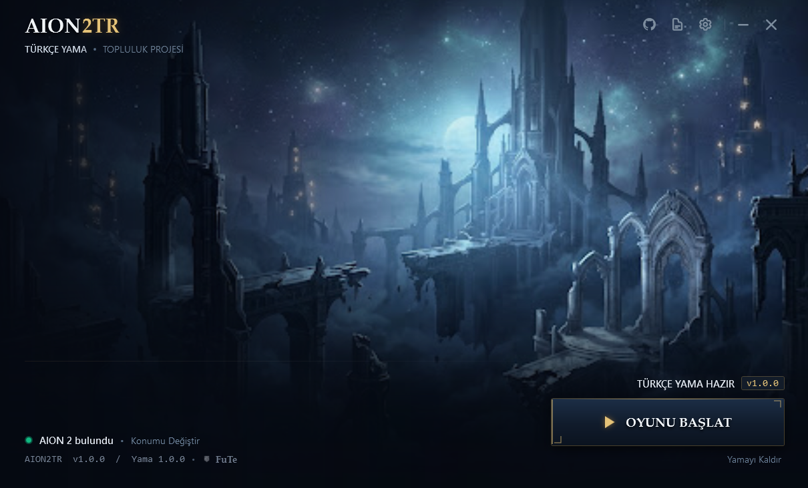

# Aion2TR — AION 2 Türkçe Yerelleştirme ve Yama Yöneticisi

Aion2TR, AION 2 için geliştirilmiş modern, güvenli, taşınabilir ve oyun güncellemelerine tam uyumlu bir Türkçe yerelleştirme yönetim aracıdır.

Geliştirici: **Furkan Tecir (FuTe)**  
Sürüm: **v1.0.3 (Portable)** (5–6 Kasım 2026 Oyun Güncellemesiyle Uyumlu)  
Lisans: **MIT**  

<div align="center">
  <br />
  <a href="https://github.com/furkantecir/AION2_TURKCE_YAMA/releases/latest">
    
  </a>
  <br /><br />
</div>

---

## Uygulama Görselleri

<div align="center">
  <table>
    <tr>
      <th align="center">Açılış Ekranı (Intro & Marka Kimliği)</th>
    </tr>
    <tr>
      <td align="center">
        <br />
        
        <br /><br />
      </td>
    </tr>
    <tr>
      <th align="center">Ana Yönetim Paneli ve Başlatıcı Arayüzü</th>
    </tr>
    <tr>
      <td align="center">
        <br />
        
        <br /><br />
      </td>
    </tr>
  </table>
</div>

---

## Genel Bakış

Aion2TR, oyunun yerelleştirme paketlerini Unreal Engine PAK yapısına uygun biçimde doğrudan işleyen modern bir altyapı üzerine kuruludur. Harici yükleyicilere, reklam yazılımlarına veya karmaşık kurulum sihirbazlarına ihtiyaç duymadan tek bir taşınabilir uygulama olarak çalışır.

Tüm işlem adımları atomik dosya operasyonları ve SHA-256 doğrulama protokolüyle yürütülür; bu sayede kullanıcı verisi ve oyun dosyaları her zaman güvence altındadır.

---

## Temel Özellikler

- **Taşınabilir (Portable) Mimari:** Sisteme herhangi bir kayıt defteri yükü getirmeden, doğrudan klasöründen tıkla-çalıştır mantığıyla çalışır.
- **Otomatik Steam Tespiti:** Steam kütüphanelerini (`libraryfolders.vdf`) ve AION 2 kurulum dizinini otomatik olarak tanır; istenildiğinde manuel dizin seçimine olanak tanır.
- **Doğrudan PAK Entegrasyonu:** Türkçe yerelleştirme verisini oyun motoru standartlarına uygun biçimde entegre eder.
- **Kapsamlı Dil Desteği:** 153.419 satırdan oluşan güncel oyun terimleri, görevler, arayüz metinleri ve eşya açıklamaları eksiksiz Türkçeleştirilmiştir.
- **Güvenli Yedekleme ve Geri Alma:** Yama kurulmadan önce orijinal oyun dosyasının yedeği otomatik olarak alınır. "Orijinale Dön" seçeneğiyle tek tıkla orijinal duruma geri dönülebilir.
- **Doğrudan Oyunu Başlatma:** Yama kurulumunun ardından doğrudan başlatıcı üzerinden Steam aracılığıyla oyun başlatılabilir.
- **Anti-Cheat ve Sistem Güvenliği:** Oyunun ana çalıştırılabilir dosyalarına (`.exe`), dinamik kütüphanelerine (`.dll`) veya oyun belleğine müdahale etmez; üçüncü taraf bellek enjeksiyonu içermez.

---

## Kullanım Kılavuzu

1. **İndirme:** [Releases (Sürümler)](https://github.com/furkantecir/AION2_TURKCE_YAMA/releases/latest) sayfasından `AION2TR_v1.0.3_Kurulum_Paketi.zip` arşivini indirin ve istediğiniz bir klasöre çıkartın.
2. **Başlatma:** Klasör içerisindeki `Aion2TR.exe` dosyasını çalıştırın.
3. **Dizin Kontrolü:** Uygulama oyun yolunu otomatik olarak bulacaktır. Farklı bir sürücüde kuruluysa "Gözat" ile oyun ana dizinini seçin.
4. **Yamayı Kur:** "Yamayı Kur" butonuna basarak kurulumu tamamlayın.
5. **Oyuna Giriş:** "Oyunu Başlat" butonuyla veya doğrudan Steam üzerinden oyuna giriş yapın.
6. **Kaldırma:** İstediğiniz zaman "Orijinale Dön (Yamayı Kaldır)" butonuna tıklayarak orijinal dil paketine dönebilirsiniz.

---

## Dağıtım Paketi İçeriği

```text
AION2TR_v1.0.3_Kurulum_Paketi/
├── Aion2TR.exe                     # Taşınabilir Türkçe Başlatıcı (Tek Dosya, Kurulum Gerektirmez)
├── BENI OKU - KURULUM REHBERI.txt  # Hızlı başlangıç ve güvenlik yönergeleri
└── patch/                          # Doğrulanmış Türkçe yerelleştirme veri paketi
    ├── L10NString.dat              # 153.419 satırlık Türkçe ikili veri dosyası
    ├── english_empty_stub.pak      # Güvenli dil paketi stub dosyası
    └── runtime_manifest.json       # SHA-256 bütünlük bildirimi
```

---

## Güvenlik İlkeleri

- **Dosya Bütünlüğü:** İşlem yapılan tüm dosyalar SHA-256 hash doğrulaması ile kontrol edilir.
- **Sıfır Enjeksiyon:** Bellek kancalama (memory hook), DLL enjeksiyonu veya harici arka plan servisleri kullanılmaz.
- **Geri Alınabilirlik:** Orijinal dosya bütünlüğü korunur; yama kaldırıldığında oyun orijinal durumuna döner.
- **Placeholder Koruması:** Oyun motoruna ait sistem değişkenleri (`%s`, `{0}`, `<color>` vb.) çeviri aşamasında korunarak biçimlendirme hataları önlenmiştir.

---

## Lisans ve Haklar

Telif Hakkı (c) 2026 **Furkan Tecir (FuTe)**. Tüm hakları saklıdır.
