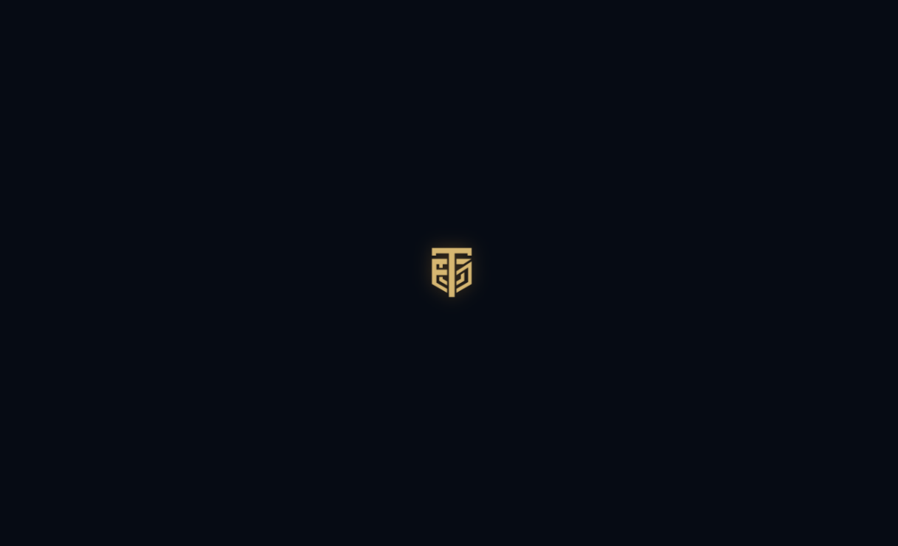
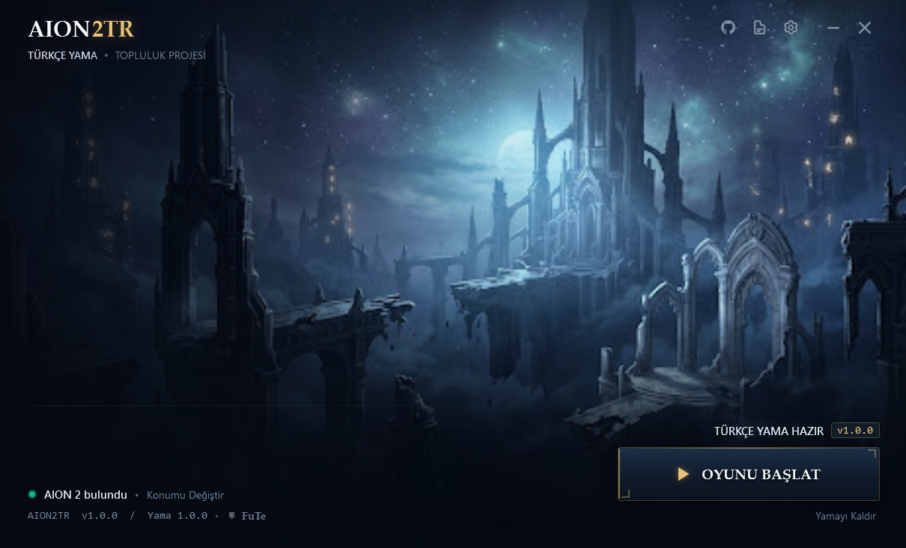

# Aion2TR — AION 2 Türkçe Yerelleştirme ve Yama Yöneticisi

Aion2TR, AION 2 için geliştirilmiş modern, güvenli, taşınabilir ve oyun güncellemelerine tam uyumlu bir Türkçe yerelleştirme yönetim aracıdır.

Geliştirici: **Furkan Tecir (FuTe)**  
Sürüm: **v2.0.0 (Portable)** (23 Kasım 2026 Oyun Güncellemesiyle Uyumlu)  
Lisans: **MIT**  

<div align="center">
  <br />
  <a href="https://github.com/furkantecir/AION2_TURKCE_YAMA/releases/latest">
    
  </a>
  <br /><br />
</div>

---

## Uygulama Görselleri

<div align="center">
  <table>
    <tr>
      <th align="center">Açılış Ekranı (Intro & Marka Kimliği)</th>
    </tr>
    <tr>
      <td align="center">
        <br />
        
        <br /><br />
      </td>
    </tr>
    <tr>
      <th align="center">Ana Yönetim Paneli ve Başlatıcı Arayüzü</th>
    </tr>
    <tr>
      <td align="center">
        <br />
        
        <br /><br />
      </td>
    </tr>
  </table>
</div>

---

## Genel Bakış

Aion2TR **v2.0.0**, oyunun resmî paketlerine müdahale etmeden doğrudan Unreal Engine 5'in yerel dil katmanını (`Engine.locres`) kullanan modern ve güvenli bir altyapı üzerine kuruludur. Harici yükleyicilere, reklam yazılımlarına veya karmaşık kurulum sihirbazlarına ihtiyaç duymadan tek bir taşınabilir uygulama olarak çalışır.

Tüm kurulum ve kaldırma adımları atomik dosya operasyonları ve SHA-256 doğrulama protokolüyle yürütülür; orijinal oyun dosyaları (`.pak`, `.sig`, `.exe`, `.dll`) hiç değiştirilmez ve `???` hatası oluşmaz.

---

## Temel Özellikler

- **Taşınabilir (Portable) Mimari:** Sisteme herhangi bir kayıt defteri yükü getirmeden, doğrudan klasöründen tıkla-çalıştır mantığıyla çalışır.
- **Otomatik Steam Tespiti:** Steam kütüphanelerini (`libraryfolders.vdf`) ve AION 2 kurulum dizinini otomatik olarak tanır; istenildiğinde manuel dizin seçimine olanak tanır.
- **Sıfır `.pak` Müdahalesi (UE5 Native `Engine.locres`):** Resmî `pakchunk*.pak` ve `.sig` dosyalarına dokunmadan `Engine/Content/Localization/Engine/Platforms/Windows/en/` ve `en-US/` yolları üzerinden Türkçe metinleri yükler.
- **Kapsamlı Dil Desteği:** 153.419 satırlık yapı içerisinde 119.522 Türkçe oyun terimi, görevler, NPC konuşmaları, arayüz metinleri ve eşya açıklamaları yer alır.
- **Tek Tıkla Temiz Kaldırma:** Yama kaldırıldığında yalnızca iki `Engine.locres` dosyası silinir ve oyun anında %100 orijinal İngilizce durumuna geri döner.
- **Doğrudan Oyunu Başlatma:** Yama kurulumunun ardından doğrudan başlatıcı üzerinden Steam aracılığıyla oyun başlatılabilir.
- **Anti-Cheat ve Sistem Güvenliği:** Oyunun ana çalıştırılabilir dosyalarına (`.exe`), dinamik kütüphanelerine (`.dll`), `.pak` arşivlerine veya oyun belleğine müdahale etmez; üçüncü taraf bellek enjeksiyonu içermez.

---

## Kullanım Kılavuzu

1. **İndirme:** [Releases (Sürümler)](https://github.com/furkantecir/AION2_TURKCE_YAMA/releases/latest) sayfasından `AION2TR_v2.0.0_Kurulum_Paketi.zip` arşivini indirin ve istediğiniz bir klasöre çıkartın.
2. **Oyun Dili Kontrolü:** Oyun içi metin dilinin **English (İngilizce)** olduğundan emin olun.
3. **Başlatma:** Klasör içerisindeki `Aion2TR.exe` dosyasını çalıştırın.
4. **Dizin Kontrolü:** Uygulama oyun yolunu otomatik olarak bulacaktır. Farklı bir sürücüde kuruluysa "Konumu Değiştir / Oyun Klasörünü Seç" ile oyun ana dizinini seçin.
5. **Yamayı Kur:** "Türkçe Yamayı Kur" butonuna basarak kurulumu tamamlayın.
6. **Oyuna Giriş:** "Oyunu Başlat" butonuyla veya doğrudan Steam üzerinden oyuna giriş yapın.
7. **Kaldırma:** İstediğiniz zaman "Yamayı Kaldır" bağlantısına tıklayarak eklenen iki `.locres` dosyasını silip orijinal İngilizce haline dönebilirsiniz.

*(Not: Daha önce eski sürümde stub `.pak` yöntemi kuruluysa, başlatıcı bunu otomatik olarak algılar ve önce Steam üzerinden "Oyun Dosyalarının Bütünlüğünü Doğrula" yapmanızı ister.)*

---

## Dağıtım Paketi İçeriği

```text
AION2TR_v2.0.0_Kurulum_Paketi/
├── Aion2TR.exe                     # Taşınabilir Türkçe Başlatıcı (Tek Dosya, Kurulum Gerektirmez)
├── BENI OKU - KURULUM REHBERI.txt  # Hızlı başlangıç ve güvenlik yönergeleri
└── patch/                          # Doğrulanmış UE5 Türkçe yerelleştirme paketi
    ├── Engine.locres               # UE5 yerel dil dosyası (153.419 kayıt / 119.522 Türkçe satır)
    └── runtime_manifest.json       # SHA-256 bütünlük bildirimi
```

---

## Güvenlik, Anti-Cheat ve Sorumluluk Bilgilendirmesi

- **Orijinal Oyun Dosyalarına Sıfır Müdahale:** `AION2.exe`, `.dll`, `.pak` ve `.sig` dosyaları %100 orijinal ve dokunulmamış olarak kalır. Steam üzerinden dosya bütünlüğü doğrulaması yapıldığında eksik veya değişmiş dosya görünmez.
- **Sıfır Enjeksiyon:** Bellek kancalama (memory hook), DLL enjeksiyonu, koruma atlatma veya arka plan servisleri kullanılmaz.
- **Dosya Bütünlüğü ve Placeholder Koruması:** Tüm dosyalar SHA-256 hash doğrulaması ile kontrol edilir; oyun motoruna ait sistem değişkenleri (`%s`, `{0}`, `<color>` vb.) çeviri aşamasında korunmuştur.
- **EULA ve Kullanıcı Sorumluluğu:** Çevrimiçi bir MMORPG oyunda resmî olmayan herhangi bir dosya eklemesi NCSoft kullanıcı sözleşmesi (EULA) gereği teorik olarak %0 ban riski garantisi veremez; kullanım sorumluluğu tamamen kullanıcıya aittir. Teknik olarak mevcut en düşük riskli (salt görsel `.locres` katmanı) yöntem uygulanmıştır. Tedbir amaçlı büyük oyun güncellemeleri ve bakım günleri öncesinde tek tıkla "Yamayı Kaldır" yapmanız önerilir.

---

## Lisans ve Haklar

Telif Hakkı (c) 2026 **Furkan Tecir (FuTe)**. Tüm hakları saklıdır.
Bu proje [MIT Lisansı](LICENSE) altında sunulmaktadır.
