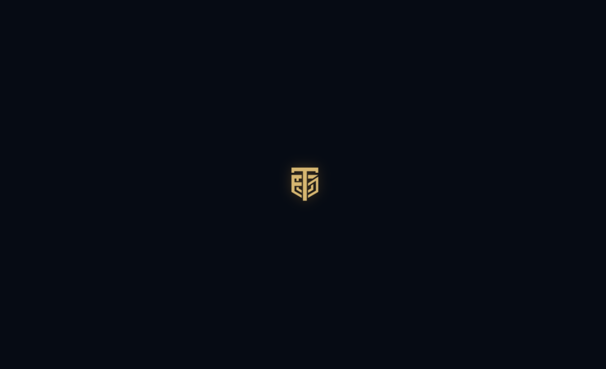
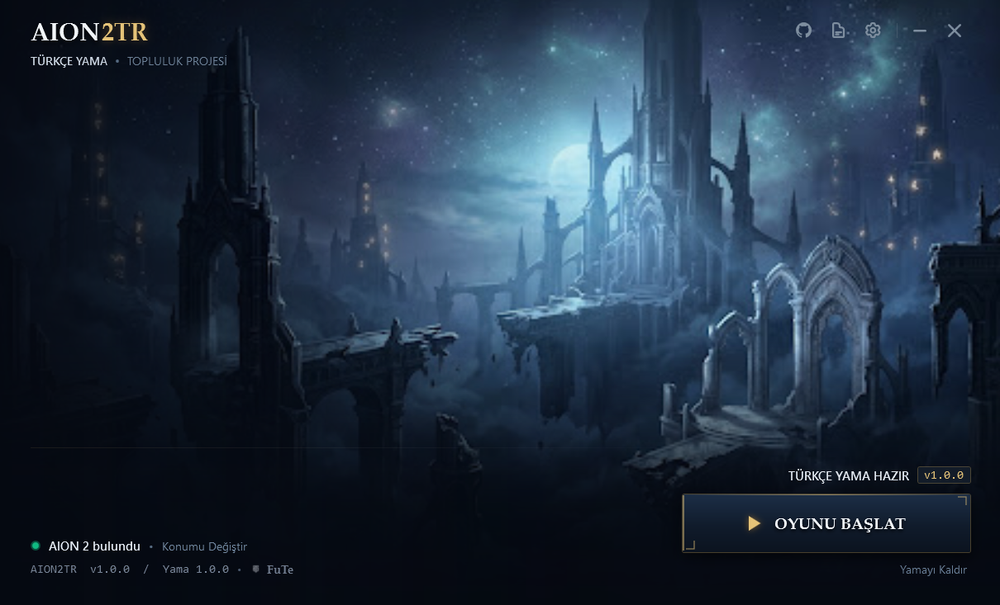

# Aion2TR — AION 2 Türkçe Yerelleştirme ve Yama Yöneticisi

Aion2TR, AION 2 için geliştirilmiş modern, güvenli, taşınabilir ve oyun güncellemelerine tam uyumlu bir Türkçe yerelleştirme yönetim aracıdır.

Geliştirici: **Furkan Tecir (FuTe)**  
Sürüm: **v1.0.2 (Portable)** (2026-10-29 Oyun Güncellemesiyle Uyumlu)  

---

## Uygulama Görselleri

<div align="center">
  <table>
    <tr>
      <th align="center">Açılış Ekranı (Intro & Marka Kimliği)</th>
    </tr>
    <tr>
      <td align="center">
        <br />
        
        <br /><br />
      </td>
    </tr>
    <tr>
      <th align="center">Ana Yönetim Paneli ve Başlatıcı Arayüzü</th>
    </tr>
    <tr>
      <td align="center">
        <br />
        
        <br /><br />
      </td>
    </tr>
  </table>
</div>

---

## Genel Bakış

Aion2TR, oyunun yerelleştirme paketlerini Unreal Engine PAK yapısına uygun biçimde doğrudan işleyen modern bir altyapı üzerine kuruludur. Harici yükleyicilere, reklam yazılımlarına veya karmaşık kurulum sihirbazlarına ihtiyaç duymadan tek bir taşınabilir uygulama olarak çalışır.

Tüm işlem adımları atomik dosya operasyonları ve SHA-256 doğrulama protokolüyle yürütülür; bu sayede kullanıcı verisi ve oyun dosyaları her zaman güvence altındadır.

---

## Temel Özellikler

- **Taşınabilir (Portable) Mimari:** Sisteme herhangi bir kayıt defteri yükü getirmeden, doğrudan klasöründen tıkla-çalıştır mantığıyla çalışır.
- **Otomatik Steam Tespiti:** Steam kütüphanelerini (`libraryfolders.vdf`) ve AION 2 kurulum dizinini otomatik olarak tanır; istenildiğinde manuel dizin seçimine olanak tanır.
- **Doğrudan PAK Entegrasyonu:** Türkçe yerelleştirme verisini `pakchunk502000-Windows_0_P.pak` arşivine standartlara uygun biçimde entegre eder.
- **Kapsamlı Dil Desteği:** 153.185 satırdan oluşan güncel oyun terimleri, görevler, arayüz metinleri ve eşya açıklamaları eksiksiz Türkçeleştirilmiştir.
- **Güvenli Yedekleme ve Geri Alma:** Yama kurulmadan önce orijinal oyun dosyasının yedeği otomatik olarak alınır. "Orijinale Dön" seçeneğiyle tek tıkla orijinal duruma geri dönülebilir.
- **Doğrudan Oyunu Başlatma:** Yama kurulumunun ardından doğrudan başlatıcı üzerinden Steam aracılığıyla oyun başlatılabilir.
- **Anti-Cheat ve Sistem Güvenliği:** Oyunun ana çalıştırılabilir dosyalarına (`.exe`), dinamik kütüphanelerine (`.dll`) veya oyun belleğine müdahale etmez; üçüncü taraf bellek enjeksiyonu içermez.

---

## Kullanım Kılavuzu

1. **İndirme:** `AION2TR_v1.0.1_Kurulum_Paketi.zip` arşivini istediğiniz bir dizine çıkartın.
2. **Başlatma:** Klasör içerisindeki `Aion2TR.exe` dosyasını çalıştırın.
3. **Dizin Kontrolü:** Uygulama oyun yolunu otomatik olarak bulacaktır. Farklı bir sürücüde kuruluysa "Gözat" ile oyun ana dizinini seçin.
4. **Yamayı Kur:** "Yamayı Kur" butonuna basarak kurulumu tamamlayın.
5. **Oyuna Giriş:** "Oyunu Başlat" butonuyla veya doğrudan Steam üzerinden oyuna giriş yapın.
6. **Kaldırma:** İstediğiniz zaman "Orijinale Dön (Yamayı Kaldır)" butonuna tıklayarak orijinal dil paketine dönebilirsiniz.

---

## Güvenlik İlkeleri

- **Dosya Bütünlüğü:** İşlem yapılan tüm dosyalar SHA-256 hash doğrulaması ile kontrol edilir.
- **Sıfır Enjeksiyon:** Bellek kancalama (memory hook), DLL enjeksiyonu veya harici arka plan servisleri kullanılmaz.
- **Geri Alınabilirlik:** Orijinal dosya bütünlüğü korunur; yama kaldırıldığında oyun orijinal durumuna döner.
- **Placeholder Koruması:** Oyun motoruna ait sistem değişkenleri (`%s`, `{0}`, `<color>` vb.) çeviri aşamasında korunarak biçimlendirme hataları önlenmiştir.

---

## Proje Yapısı

```text
Aion2TR/
├── src/
│   ├── Aion2TR.App/            # WPF modern başlatıcı arayüzü (MVVM)
│   ├── Aion2TR.Core/           # Temel iş mantığı, modeller ve veri yapıları
│   └── Aion2TR.Infrastructure/ # PAK işleme, Steam tespiti ve yedekleme servisleri
├── v2/
│   ├── src/                    # Çeviri eşleme ve paketleme araçları
│   └── data/                   # Eşleme ve sözlük veritabanı
├── tests/
│   └── Aion2TR.Tests/          # xUnit test paketi
├── Kurulum Paketi/             # Taşınabilir son kullanıcı dağıtım paketi
├── screenshots/                # Uygulama ekran görüntüleri
├── docs/                       # Teknik mimari ve güvenlik dokümanları
└── Aion2TR.sln                 # Visual Studio / .NET çözüm dosyası
```

---

## Derleme ve Geliştirme

Projeyi kaynak koddan derlemek için:

1. **Gereksinimler:** Windows 10/11, .NET 8 veya .NET 10 SDK
2. **Derleme:**
   ```powershell
   dotnet build Aion2TR.sln -c Release
   ```
3. **Testlerin Çalıştırılması:**
   ```powershell
   dotnet test Aion2TR.sln
   ```
4. **Taşınabilir Paket Yayını:**
   ```powershell
   dotnet publish src/Aion2TR.App/Aion2TR.App.csproj -c Release -r win-x64 --self-contained true -p:PublishSingleFile=true -p:IncludeNativeLibrariesForSelfExtract=true
   ```

---

## Lisans ve Haklar

Telif Hakkı (c) 2026 **Furkan Tecir (FuTe)**. Tüm hakları saklıdır.

