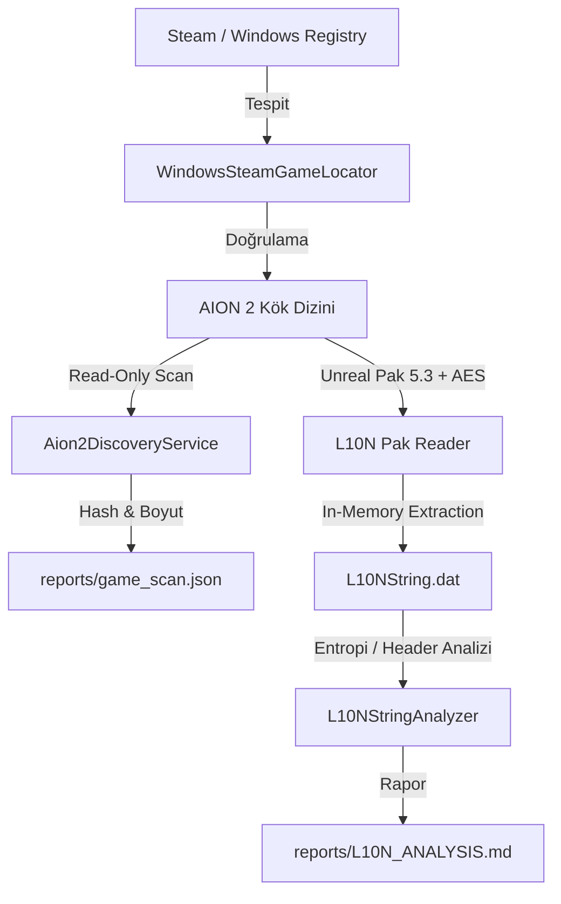

# Aion2TR — Mimari ve Tasarım Dokümanı (ARCHITECTURE.md)

Bu doküman, **Aion2TR** (AION 2 Türkçe Yerelleştirme ve Güvenli Yama Yöneticisi) projesinin katmanlı mimarisini, veri akışını ve güvenlik sınırlarını açıklar.

---

## 1. Katmanlı Mimari (Onion / Clean Architecture)

Proje, bağımlılıkları minimumda tutan ve oyun dosya operasyonlarını soyutlayan 4 ana projeden oluşur:

```
Aion2TR/
├── src/
│   ├── Aion2TR.Core/           # Domain modelleri, arayüzler, validasyonlar, salt POCO kuralları
│   ├── Aion2TR.Infrastructure/ # Windows Registry, Steam IO, VFS / Pak okuyucu, Hash servisi
│   └── Aion2TR.App/            # WPF MVVM kullanıcı arayüzü, ViewModel'ler, komutlar
├── tests/
│   └── Aion2TR.Tests/          # Unit testler, regression testleri, validatör kontrolleri
├── tools/
│   └── Aion2TR.ScannerCli/     # Otomasyon ve bağımsız read-only keşif aracı
├── docs/                       # Format analizleri, güvenlik kuralları ve mimari rehberler
└── reports/                    # Read-only tarama ve analiz çıktıları (JSON/TXT/MD)
```

---

## 2. Proje Sorumlulukları

### Aion2TR.Core
- **Model Tanımları:** `GameLocationResult`, `ScannedFileInfo`, `GameScanReport`, `TranslationEntry`, `L10NAnalysisResult`.
- **Soyutlamalar (Interfaces):**
  - `IGameLocator`: Oyunu registry, dosya sistemi veya manuel seçim ile bulma sözleşmesi.
  - `IHashService`: SHA-256 akış ve bellek bütünlük doğrulama sözleşmesi.
  - `IDiscoveryService`: Salt-okunur yerelleştirme taraması.
  - `IL10NStringAnalyzer`: Binary tablo analizi ve entropi hesabı.
  - `IPlaceholderValidator`: Metin tokenlarının (%s, {0}, vb.) çeviri sırasında kaybolmasını engelleyen kural motoru.

### Aion2TR.Infrastructure
- **WindowsSteamGameLocator:**
  1. `HKCU:\Software\Valve\Steam\SteamPath` sorgusu.
  2. `HKLM:\SOFTWARE\Valve\Steam` ve `WOW6432Node` yedeği.
  3. `libraryfolders.vdf` ayrıştırması ile tüm harici Steam disk kütüphanelerinin taranması.
  4. Klasör doğrulama (`Aion2`, `Engine`, `Paks`, `Manifest_UFSFiles_Win64.txt`).
- **Sha256HashService:** 64KB bloklarla asenkron, düşük bellek tüketimli SHA-256 akışı.
- **Aion2DiscoveryService:**
  - `Aion2\Content\Paks\L10N` altındaki tüm `.pak`, `.sig`, `.ucas`, `.utoc` dosyalarının taranması.
  - JSON ve biçimlendirilmiş TXT rapor çıktısı oluşturma.
- **VFS / Unreal Engine Entegrasyonu:**
  - `CUE4Parse` kullanılarak Unreal Engine 5.3 VFS ve AES şifreleme katmanının bellek içinde (in-memory) çözülmesi.

### Aion2TR.App (WPF)
- **MVVM Tasarımı:** Asenkron `IAsyncRelayCommand`, `CancellationToken` desteği ile donmayan UI.
- **Güvenli Arayüz:** Tek tuşla `Oyunu Tara`, `Dry Run (Simülasyon)`, `Metinleri Dışarı Aktar`, `Yamayı Kur`, `Yamayı Kaldır (Orijinale Dön)`.

---

## 3. Veri Akış Diyagramı


